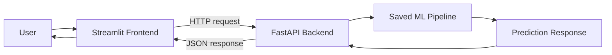

# MachineGuard — Intelligent Machine Failure Risk Assessment System

MachineGuard is an end-to-end machine learning project that estimates whether a machine's current operating conditions indicate a failure risk. A tuned Gradient Boosting classifier, trained on the UCI AI4I 2020 Predictive Maintenance Dataset, is served through a FastAPI backend and explored through a Streamlit interface. The system can be run locally or with Docker Compose.

> **Scope note:** MachineGuard is a binary failure risk *classification* demonstration. It is not a Remaining Useful Life (RUL) estimator and not a time-series forecasting system. It was trained and evaluated on a synthetic dataset and has not been tested or validated in any real industrial environment.

---

## Table of Contents

1. [Overview](#overview)
2. [Demo / Screenshots](#demo--screenshots)
3. [Key Features](#key-features)
4. [System Architecture](#system-architecture)
5. [Dataset](#dataset)
6. [Machine Learning Workflow](#machine-learning-workflow)
7. [Feature Engineering](#feature-engineering)
8. [Model Selection and Evaluation](#model-selection-and-evaluation)
9. [Final Test Results](#final-test-results)
10. [Project Structure](#project-structure)
11. [Technologies Used](#technologies-used)
12. [Installation and Local Setup](#installation-and-local-setup)
13. [Docker Deployment](#docker-deployment)
14. [API Usage](#api-usage)
15. [Running Tests](#running-tests)
16. [Limitations](#limitations)
17. [Future Improvements](#future-improvements)
18. [Author](#author)

---

## Overview

The system takes five machine operating measurements and a machine type, and returns a **failure score**, the decision **threshold**, a binary **prediction**, and a readable **status** message.

It has three parts:

- **Machine learning model:** a Gradient Boosting classifier built with Python and Scikit-learn, evaluated on a held-out test set.
- **Backend:** a FastAPI service that exposes health-check and prediction endpoints, computes the engineered `Power` feature, and runs the saved model pipeline.
- **Frontend:** a Streamlit application that collects inputs, sends them to the backend over HTTP, and displays the result.

Docker and Docker Compose are used for containerized deployment.

The distinction between the model and the application matters. The metrics reported below describe how the model behaved on a held-out sample of a synthetic dataset. The application is a working interface around that model and does not add evidence about real-world performance.

## Demo / Screenshots

No live demo is deployed. Screenshots can be added here once captured.

| View | Screenshot |
|---|---|
| Machine parameter input form |  |
| Result: no failure risk detected |  |
| Result: failure risk detected |  |
## Key Features

- Binary machine failure risk classification from five numeric measurements and one categorical machine type.
- Decision threshold of **0.20**, selected based on validation F1-score rather than using the default 0.50.
- FastAPI backend with `GET /health`, `POST /predict`, and interactive Swagger documentation at `/docs`.
- Strict request validation: non-positive values, invalid machine types, and unexpected extra fields are rejected with HTTP 422.
- Server-side calculation of the engineered `Power` feature, so clients send only raw measurements.
- Streamlit interface with grouped inputs, a score gauge, a clear classification result, and a submitted-parameter summary.
- The frontend communicates with the backend only through HTTP using `requests`. It does not load the model or duplicate feature engineering.
- Configurable backend address in the frontend through the `API_URL` environment variable.
- Dockerized deployment with Docker Compose.
- Five automated API tests with `pytest`.

## System Architecture



**Request flow:**

1. The user enters machine parameters in the Streamlit form.
2. The frontend sends a `POST /predict` request to the FastAPI backend.
3. The backend validates the input, calculates the `Power` feature, and passes the data to the saved pipeline loaded from `artifacts/machineguard_model.joblib`.
4. The backend returns the failure score, threshold, prediction, and status as JSON.
5. The frontend renders the result.

## Dataset

- **Source:** UCI AI4I 2020 Predictive Maintenance Dataset.
- **Size:** 10,000 records.
- **Class balance:** 3.39% failure cases and 96.61% normal cases, so the dataset is strongly imbalanced.
- **Nature:** the dataset is **synthetic**. It was generated to resemble industrial predictive maintenance data and is not drawn from real machines.
- **Model inputs:** air temperature (K), process temperature (K), rotational speed (RPM), torque (Nm), tool wear (min), machine type (`L`, `M`, `H`), and the engineered `Power` feature.
- **Excluded columns:** the failure-mode indicator columns `TWF`, `HDF`, `PWF`, `OSF`, and `RNF` were **excluded from the model features**. These columns describe *how* a failure occurred and are derived from the same event as the target, so including them would cause target leakage.

## Machine Learning Workflow

1. **Data inspection:** review of distributions, missing values, and class imbalance.
2. **Leakage prevention:** removal of `TWF`, `HDF`, `PWF`, `OSF`, and `RNF` from the feature set.
3. **Data splitting:** a 70% / 15% / 15% train / validation / test split with `random_state=42`. The final test set was held out and evaluated only after model selection and threshold tuning.
4. **Feature engineering experiments:** two engineered features (`Power`, `Temp_Diff`) were evaluated through feature-ablation experiments.
5. **Model tuning:** hyperparameter search for a Gradient Boosting classifier using `RandomizedSearchCV`.
6. **Threshold selection:** a classification threshold was chosen using validation F1-score.
7. **Final evaluation:** a single evaluation of the selected model and threshold on the held-out test set.
8. **Serialization and serving:** the final pipeline was saved with `joblib` and is loaded by the FastAPI backend.

## Feature Engineering

Two engineered features were evaluated:

| Feature | Definition | Outcome |
|---|---|---|
| `Power` | `Power = Torque × Rotational Speed × (2π / 60)`, in Watts | **Retained** based on the feature-ablation experiments |
| `Temp_Diff` | Process temperature minus air temperature | **Excluded** from the final feature set |

In the `Power` formula, torque is in Nm and rotational speed is in RPM, so multiplying by 2π / 60 converts RPM to radians per second and gives power in Watts.

The backend is responsible for calculating `Power` before passing data to the saved pipeline. The Streamlit frontend sends only the raw measurements and does not implement any feature engineering.

## Model Selection and Evaluation

**Final model:** Tuned Gradient Boosting Classifier (Scikit-learn), model version `1.0.0`.

**Hyperparameter optimization:**

| Setting | Value |
|---|---|
| Search method | `RandomizedSearchCV` |
| Iterations (parameter configurations sampled) | 40 |
| Cross-validation | 5-fold `StratifiedKFold` |
| Optimization metric | `average_precision` (PR-AUC) |

**Why PR-AUC?** With only 3.39% positive cases, accuracy alone is misleading: a model that always predicts "no failure" would achieve 96.61% accuracy while detecting no failures.

ROC-AUC measures the model's ability to rank positive cases above negative cases across different thresholds. However, PR-AUC focuses on the trade-off between precision and recall, making it particularly informative when evaluating detection of a rare positive class. For this reason, Average Precision was selected as the primary optimization metric during hyperparameter tuning.

**Threshold selection:** the selected threshold of **0.20** was chosen from the thresholds that were tested, based on validation F1-score, which balances precision and recall. It is not necessarily the best possible threshold, and it was **not** derived from a real operational cost model. It should not be presented as an industrially optimal threshold. In a real deployment, the costs of missed failures and false alarms would need to be defined and the threshold re-tuned accordingly.

## Final Test Results

The final test set (15% of the data, 1,500 records) was evaluated only after model selection and threshold tuning were complete.

| Metric | Score |
|---|---:|
| PR-AUC | 0.8559 |
| ROC-AUC | 0.9788 |
| Accuracy | 0.9847 |
| Precision | 0.7692 |
| Recall | 0.7843 |
| F1-score | 0.7767 |

**Confusion matrix (threshold = 0.20):**

|  | Predicted: No failure | Predicted: Failure |
|---|---:|---:|
| **Actual: No failure** | 1437 (TN) | 12 (FP) |
| **Actual: Failure** | 11 (FN) | 40 (TP) |

On this test set, the model identified 40 of 51 failure cases and raised 12 false alarms among 1,449 normal cases.

**Interpretation limits:**

- The dataset is synthetic, so these results do not establish real-world industrial performance.
- The test set contains only 51 failure cases, so the precision and recall estimates carry meaningful uncertainty.
- The failure score is the positive-class score returned by the model's `predict_proba()` method. It has not been calibrated and should not be interpreted as a reliable estimate of the real-world probability of failure.

## Project Structure

```text
MachineGuard/
├── app/
│   └── main.py                    # FastAPI application
├── frontend/
│   ├── app.py                     # Streamlit interface
│   ├── Dockerfile                 # Frontend image
│   └── requirements.txt           # Frontend dependencies
├── artifacts/
│   └── machineguard_model.joblib  # Saved ML pipeline
├── tests/
│   └── test_api.py                # API tests
├── Dockerfile                     # Backend image
├── .dockerignore
├── docker-compose.yml             # Backend and frontend services
├── requirements.txt               # Backend dependencies
├── requirements-dev.txt           # Development and test dependencies
└── README.md
```

## Technologies Used

| Area | Technology |
|---|---|
| Language | Python 3.13 (also the base image for both containers) |
| Machine learning | Scikit-learn 1.6.1 (Gradient Boosting, `RandomizedSearchCV`, `StratifiedKFold`) |
| Data handling | NumPy 2.1.3, pandas 2.3.3 |
| Model serialization | joblib 1.6.0 |
| Backend | FastAPI 0.163.0, Uvicorn 0.54.0 |
| Frontend | Streamlit |
| HTTP client (frontend to backend) | Requests |
| Testing | pytest |
| Containerization | Docker, Docker Compose |

Backend dependencies are pinned in `requirements.txt`. The frontend dependencies (`streamlit`, `requests`) in `frontend/requirements.txt` are not pinned to specific versions.

## Installation and Local Setup

**Prerequisites:** Python 3.13 (the version used for development) and Git.

**1. Clone the repository**

```bash
git clone https://github.com/ARWA-ABOU-ATTIA/MachineGuard.git
cd MachineGuard
```

**2. Create and activate a virtual environment**

```bash
python -m venv .venv
source .venv/bin/activate        # Windows: .venv\Scripts\activate
```

**3. Install dependencies**

```bash
pip install -r requirements.txt
pip install -r frontend/requirements.txt
```

**4. Start the backend**

```bash
uvicorn app.main:app --host 0.0.0.0 --port 8000
```

**5. Start the frontend** in a second terminal, with the virtual environment active:

```bash
streamlit run frontend/app.py
```

**6. Open the application**

| Service | URL |
|---|---|
| Streamlit frontend | http://localhost:8501 |
| FastAPI backend | http://localhost:8000 |
| Swagger documentation | http://localhost:8000/docs |

The frontend reads the backend address from the `API_URL` environment variable and falls back to `http://localhost:8000` when it is not set, which matches the local setup above. To point the frontend at a different backend, set the variable before starting Streamlit.

## Docker Deployment

The application runs as two services defined in `docker-compose.yml`. Both images are built on `python:3.13-slim`.

| Service | Container name | Build context | Host port |
|---|---|---|---|
| `backend` (FastAPI) | `machineguard-api` | `.` (root `Dockerfile`) | `8000` |
| `frontend` (Streamlit) | `machineguard-frontend` | `./frontend` (`frontend/Dockerfile`) | `8501` |

Both services use `restart: unless-stopped`. The backend image contains the `app/` directory and the `artifacts/` directory. The frontend image contains only `frontend/app.py`.

**Backend and frontend communication:** inside Docker, `localhost` refers to the container itself, so the frontend container cannot reach the backend through `localhost:8000`. The Compose file therefore sets `API_URL=http://backend:8000` on the `frontend` service, which addresses the backend by its Compose service name over the Compose network. The frontend `depends_on` the backend, which controls start order only; it does not wait for the backend to be ready to accept requests. If the page loads before the backend is up, reload it after a few seconds.

**Build and start the services**

```bash
docker compose up --build
```

Add `-d` to run in the background:

```bash
docker compose up --build -d
```

**View running containers**

```bash
docker compose ps
```

**View logs**

```bash
docker compose logs -f
```

To follow a single service:

```bash
docker compose logs -f backend
docker compose logs -f frontend
```

**Stop the services**

```bash
docker compose down
```

**Local URLs:**

- Frontend: http://localhost:8501
- Backend: http://localhost:8000
- API documentation: http://localhost:8000/docs

## API Usage

### Endpoints

| Method | Path | Description |
|---|---|---|
| `GET` | `/health` | Backend health check. The frontend reads `model` and `version` from the response. |
| `POST` | `/predict` | Returns a failure risk assessment for one set of machine measurements. |
| `GET` | `/docs` | Interactive Swagger UI. |

### Prediction request

| Field | Type | Validation rule |
|---|---|---|
| `air_temperature` | number | Must be greater than 0 (kelvin) |
| `process_temperature` | number | Must be greater than 0 (kelvin) |
| `rotational_speed` | number | Must be greater than 0 (RPM) |
| `torque` | number | Must be greater than 0 (Nm) |
| `tool_wear` | number | Must be greater than or equal to 0 (minutes) |
| `machine_type` | string | Must be one of `L`, `M`, or `H` |

Extra request fields are forbidden. The `Power` feature is **not** sent by the client; the backend computes it.

### Example request

```bash
curl -X POST http://localhost:8000/predict \
  -H "Content-Type: application/json" \
  -d '{
    "air_temperature": 300.0,
    "process_temperature": 310.0,
    "rotational_speed": 1500.0,
    "torque": 40.0,
    "tool_wear": 100.0,
    "machine_type": "L"
  }'
```

### Prediction response

| Field | Description |
|---|---|
| `failure_score` | Positive-class score from the model's `predict_proba()` method (0 to 1). Not calibrated. |
| `threshold` | The decision threshold used (0.20). |
| `prediction` | `1` for failure risk, `0` for no failure risk. |
| `status` | A human-readable classification label. |

Example response:

```json
{
  "failure_score": 0.000401,
  "threshold": 0.2,
  "prediction": 0,
  "status": "No Failure Risk Detected"
}
```

### Validation errors

Invalid requests return HTTP `422`. This covers non-positive values for `air_temperature`, `process_temperature`, `rotational_speed`, or `torque`; a negative `tool_wear`; a `machine_type` other than `L`, `M`, or `H`; and any extra field. The Streamlit frontend converts a `422` response into a readable message instead of showing the raw error.

## Running Tests

The project includes five API tests in `tests/test_api.py`, all of which passed.

```bash
pip install -r requirements-dev.txt
pytest
```

These tests cover the API layer. Model quality is assessed through the offline evaluation described above, not through these tests.

## Limitations

- **Synthetic data:** the AI4I 2020 dataset is synthetic. The reported metrics do not demonstrate performance on real machines or in any real industrial environment.
- **Task scope:** the system classifies failure risk from a single snapshot of measurements. It does not estimate Remaining Useful Life, track a machine over time, or forecast future failures.
- **Uncalibrated score:** the failure score is the positive-class score from `predict_proba()`. It has not been calibrated and should not be read as a reliable estimate of real-world failure probability.
- **Threshold choice:** the 0.20 threshold was selected by validation F1-score among the tested thresholds. It was not based on real maintenance or downtime costs.
- **Limited test sample:** the test set contains only 51 failure cases, which limits the statistical confidence in the reported precision and recall.
- **No monitoring or retraining:** there is no data drift monitoring, model versioning pipeline, or retraining workflow.
- **Demonstration scope:** the project is a portfolio demonstration and has not been hardened or validated for real-world operation.

## Future Improvements

- Evaluate probability calibration (for example, reliability curves, Brier score, or calibration methods) before presenting scores as probabilities.
- Select the threshold using an explicit cost model of missed failures versus false alarms.
- Report confidence intervals or repeated-split results to quantify metric uncertainty.
- Compare against additional model families and add model explainability (for example, feature importance or SHAP).
- Add a readiness health check to Docker Compose so the frontend starts only after the backend is ready.
- Pin the frontend dependency versions.
- Add model versioning, experiment tracking, and a CI pipeline for tests and image builds.
- Add input and prediction logging, and drift monitoring.
- Validate on real operational data if it becomes available.

## Author

**Arwa Abou-Attia**

- GitHub: https://github.com/ARWA-ABOU-ATTIA
- Repository: https://github.com/ARWA-ABOU-ATTIA/MachineGuard
- LinkedIn: https://www.linkedin.com/in/arwa-abou-attia/
